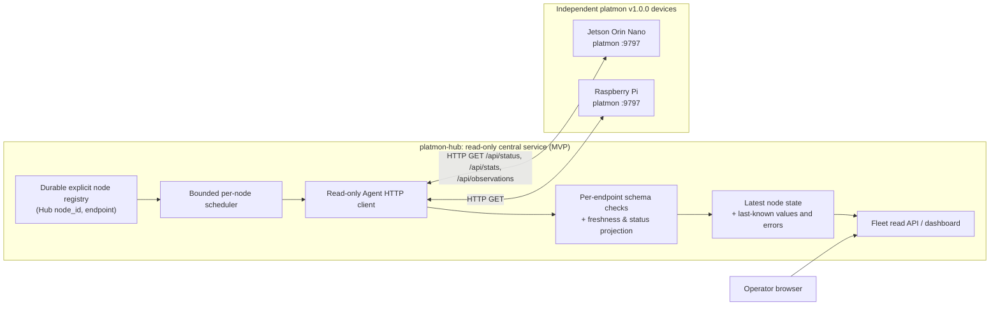
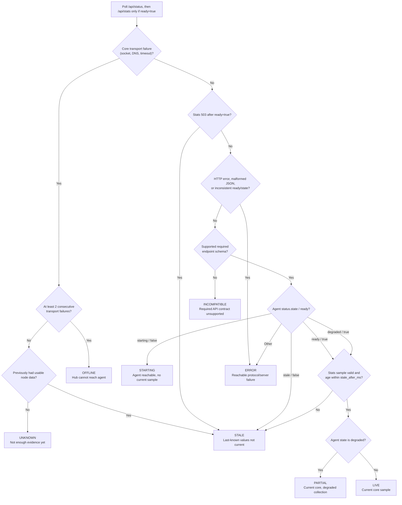

# platmon-hub architecture (proposed)

**Status:** Proposed, for design review before implementation.  
**Upstream baseline:** [platmon v1.0.0](https://github.com/platmon/platmon/releases/tag/v1.0.0), API schemas as pinned in [the consumption contract](agent-contract.md).  
**MVP targets:** Jetson Orin Nano and Raspberry Pi; separately installed and independently running platmon agents.

## 1. Goals and system boundary

Hub is a **central, read-only monitoring application**. Its responsibilities are a durable inventory of explicitly registered devices, concurrent retrieval of each agent's already published results, current-status projection with provenance/age, and a fleet-level view. Later milestones may add server-side metrics retention and alerts.

The existing `platmon` agent remains responsible for local hardware collection, its own freshness semantics, per-board optional sensors, local CLI/Web UI, and local short history. Hub **does not import agent Python modules**, duplicate `/proc` or `/sys` collectors, reconfigure probe targets, or make agent availability contingent on Hub. Both repositories release independently.

Out of scope for the initial MVP: agent installation/FOTA/update orchestration, remote commands, control plane, auto-discovery, alert delivery, external internet access, telemetry Push, historical backfill, and any modification to platmon v1.0.0.

## 2. Proposed topology



The browser talks **only to Hub**. Hub talks to each configured agent. The agents do not call Hub. The Hub UI must not expose an arbitrary URL-fetch/proxy endpoint.

## 3. Logical components

| Component | Scope and invariants | MVP storage |
| --- | --- | --- |
| NodeRegistry | Stable `node_id`, display name, agent endpoint, enabled flag; explicitly configured and validated; reject duplicate IDs/endpoints. | Durable local registry (format to be chosen in backend PR). |
| PollScheduler | Each device has its own schedule and deadlines; no overlapping polls per device; bounded global concurrency, jitter and failure backoff. | In memory. |
| AgentClient | Read-only HTTP GET, response-size bound, JSON validation, per-endpoint schema/version gates. | In memory. |
| StateProjector | Separates transport reachability, agent core state, sample freshness, and independent optional groups. | Latest per-node state in memory. |
| Hub read API/Web | Fleet summary and node detail, including last success, source age, and collection issues; never writes to an agent. | In memory; no server-side time series initially. |
| HistoryStore (later) | Time-series persistence, retention, discontinuities and query indexing. | SQLite candidate for later PR; not required for initial status MVP. |

### Node identity

Hub must assign and durably retain an opaque `node_id` (UUID recommended). The endpoint URL and hostname are **mutable attributes**, not the identity. Two nodes must never be automatically merged because they report the same hostname, IP, model, or sensor source identifier. Renaming, IP migration and Hub restart retain the registered ID. Replacing hardware or intentionally reassigning an agent to a node ID requires an explicit operator decision.

Agent `sample.instance_id` is instead the **process lifetime** identifier; it changes when platmon restarts. Within that instance, `(instance_id, sequence)` identifies a published core sample. See [agent contract](agent-contract.md) for deduplication and identity of low-frequency observations.

## 4. Poll cycle and load controls

**Proposed configurable initial defaults** (these are Hub design choices, not platmon API guarantees):

| Item | Proposed MVP default | Why |
| --- | --- | --- |
| Core `/api/status` and `/api/stats` | Per node every 5 seconds | Lower load than the agent's default 1-second local sampling. |
| `/api/observations` | Per node every 10 seconds | Independent low-frequency publishers; always use each group's returned age/interval. |
| `/api/history` | Do not poll in MVP | Local history is short, volatile, and not Hub persistence. |
| HTTP deadline | Status 2 s; stats 2 s; observations 3 s | Bounded failure isolation. Tune with real devices. |
| Consecutive transport failures for `offline` | 2 | Avoid a single transient failure being presented as a confirmed outage. |
| Concurrent agent polls | Hard global cap (initial proposal: 16) | Resource safety as nodes are added. |

Core processing per node:

1. Schedule a single poll after the node's previous poll finishes; use monotonic scheduler time and a small, bounded jitter to avoid synchronizing all devices.
2. GET `/api/status`; validate HTTP 200, JSON structure, schema 1, `state` and boolean `ready`. A successful HTTP response is **not** necessarily a healthy sample.
3. If `ready is true`, GET `/api/stats` and validate schema 1, data freshness and identity. A 503 here (including a race with stale transition) is a **no-current-snapshot event**, not proof the host is offline. If `ready is false`, retain last-known values only as explicitly noncurrent; don't call `/api/stats` solely to force collection.
4. Independently, GET `/api/observations` on its own slower schedule. Validate schema 2, and keep per-group age and state; disabled/absent groups are not synthetic errors. Failures in observations never prevent a valid core snapshot from being displayed.
5. Publish a new Hub observation atomically for that node, including Hub receipt timestamp, completion/deadline/result and any recorded error. Never synthesize zero for an absent measurement; never promote cached old values to current.

### Polling sequence (proposed MVP)

The diagram separates core polling from the independently scheduled low-frequency observations. The Hub serves cached projections to browsers; browser requests do **not** trigger device collection. Agent `/api/history` is **not** polled in the MVP.

```mermaid
sequenceDiagram
    autonumber
    participant Viewer as Fleet browser
    participant Hub as Hub read API / cache
    participant Poller as Per-node poll scheduler
    participant Agent as Registered platmon agent

    Viewer->>Hub: GET fleet view
    Hub-->>Viewer: Last-known nodes, ages, and error reasons

    loop Core schedule: 5 s per node (proposed)
        Poller->>Agent: GET /api/status
        alt Valid schema 1, ready=true
            Agent-->>Poller: state, ready, instance_id, sample
            Poller->>Agent: GET /api/stats
            alt Valid schema 1 and current snapshot
                Agent-->>Poller: instance_id, sequence, data_age_ms, stale_after_ms
                Poller->>Hub: Project core state, receipt age, and sample identity
            else 503 / unsupported schema / timeout / invalid response
                Agent-->>Poller: No current data or failure
                Poller->>Hub: Apply stale, incompatible, error, or transport-failure policy
            end
        else Valid schema 1, ready=false
            Agent-->>Poller: starting or stale
            Poller->>Hub: Retain old metrics as noncurrent; skip stats
        else Transport / protocol / schema failure
            Poller->>Hub: Record per-node failure; preserve other nodes
        end
    end

    loop Independent observations schedule: 10 s per node (proposed)
        Poller->>Agent: GET /api/observations
        alt Valid schema 2
            Agent-->>Poller: Group states, IDs, ages and optional data
            Poller->>Hub: Update low-frequency groups independently
        else 404 / incompatible schema / timeout
            Poller->>Hub: Mark optional-endpoint issue only; keep core status
        end
    end

    Viewer->>Hub: Refresh fleet view
    Hub-->>Viewer: Current projections (no direct Agent access)
```

Per-node tasks may run concurrently, but no node's slow request may block another node's schedule. Respect finite response size, per-request deadlines and caps on background tasks. Retry with bounded backoff; successful replies reset the consecutive transport failure counter. Avoid automatic retry loops at subsecond rates. Status and metrics should carry separate error information so optional endpoint failures cannot masquerade as transport offline.

## 5. State and freshness model

There are **three independent dimensions**, all exposed in diagnostics: (1) Hub-to-agent transport, (2) the agent's core `state` and `ready`, and (3) freshness/quality of the last accepted metrics and optional observations.

| Fleet headline | Rule (proposed) | What the UI must say |
| --- | --- | --- |
| `live` | Valid status schema, `ready=true`, `state=ready`, current core snapshot | Live; show exact data age. |
| `partial` | Valid `ready=true`, `state=degraded`, current snapshot | Partial; show collector/attempt issue; not offline. |
| `starting` | Agent replies `state=starting`, `ready=false` | Reachable, waiting for first sample. |
| `stale` | Agent replies `state=stale`, `ready=false`, or previously cached metrics exceed freshness limit | Reachable/stale or last-known/not current; do not display metrics as live. |
| `offline` | Two consecutive connection, DNS or HTTP timeout failures from Hub | Unreachable from Hub; retained values are last known. |
| `incompatible` | Unknown/missing mandatory schema or unsupported version | Reachable if HTTP replied, but payload not compatible. |
| `error` | Reachable HTTP endpoint returning invalid/error responses (e.g., non-200 status, invalid JSON) | Protocol/server error, not confirmed network outage. |
| `unknown` | Device not yet polled or insufficient evidence after the first unreachable attempt | Checking or connection uncertain. |

### Fleet headline decision flow (proposed)

This flow derives the **Hub's headline state**, not platmon's internal collector state. `/api/status` is mandatory and `/api/stats` is requested only when `ready=true`. An optional `/api/observations` failure is intentionally outside this core decision path. `offline` requires repeated *core transport* failures, not an HTTP 503 or an unsupported sensor.



The transport-failure count resets on a successful **valid** status response. For a valid status with `ready=true`, the reported `sample.data_age_ms` is evaluated against `sample.stale_after_ms` from `/api/stats`, with cached age increasing by Hub monotonic elapsed time. A stats timeout uses the transport-failure policy; a stats 503 means the current sample disappeared, **not** that the host is offline. Malformed/unsupported low-frequency observations remain an independent optional diagnostic.

On the **first** transport failure after valid data, the headline becomes `stale` (last-known, with poll error); if there has never been a valid response it remains `unknown` (with poll error). After the second consecutive transport failure, `offline`. A successful valid status response resets that counter, then uses the agent's own state. Response/schema errors are not counted as proof that the host is offline.

Agent freshness is determined by its returned `sample.data_age_ms` and `sample.stale_after_ms`, not by comparing agent wall-clock `started_at` to Hub wall time. When displaying a cached reply, conservatively increase age by Hub monotonic elapsed time since receipt; the agent age describes the value at the response instant and excludes some network latency. If the age has expired locally, label the retained metrics stale even if the last agent reply said `ready`. Repeated reads of the same `(instance_id, sequence)` are **not** new samples.

A low-frequency group's `stale` flag and `data_age_ms`/`stale_after_ms` are assessed **independently** of core readiness. A `partial` or `error` optional group merits attention; `unavailable` from unsupported hardware is not automatically degradation. Hub must not infer that absent GPU, fan, Wi-Fi or configured probe means an outage.

## 6. Failure domains and security

- Agents stay fully usable when Hub is down; no agent changes or restarts required.
- A blocked or restarting device is isolated with per-node request deadlines and bounded concurrency; no global stall.
- Upstream HTTP has **no authentication** in platmon v1.0.0; initial deployment is limited to a trusted management LAN or VPN. Never expose port 9797 directly to the public internet.
- Hub's administration and read UI should bind to loopback or a protected interface until authentication and TLS/reverse-proxy policy is defined. Do not expose raw arbitrary URL selection, open proxying, agent writes or secret-bearing error details.
- Registry endpoints require explicit operator approval; avoid server-side request forgery via user-supplied destinations. Read-only polling is not a permission to scan networks.
- Sensor labels, hostname and collector-reported strings are untrusted text for web rendering (escape, no HTML injection).

## 7. Milestones and deferred design

1. **This PR:** architecture, upstream API interpretation, ADR and executable-style acceptance criteria, no implementation/dependencies.
2. **Backend:** explicit persistent registry, no-overlap bounded polling, state projection, fixtures/contract tests and read-only Hub API.
3. **Dashboard:** two-node fleet summary, per-node detail and Live/Partial/Offline semantics with explicit age, reasons and unavailable values.
4. **History:** choose durability/retention, add SQLite or equivalent store, preserve gaps, optional charts. Alert transport, authentication for remote access, discovery/Push and dynamic device enrollment are separate follow-on decisions.

A scaling target of tens to hundreds of devices is an **architectural aspiration**, not a tested capacity guarantee. Measure agent HTTP cost, Hub CPU/RSS, network traffic, backoff behavior and p95 polling delay before publishing such a claim.

## 8. Review checklist

Before accepting this proposal, reviewers should confirm the [contract interpretation](agent-contract.md), two-device [verification plan](mvp-acceptance.md) and [ADR](adr/0001-http-pull-and-device-identity.md). No compatibility guarantees are introduced by this documentation until a tested Hub implementation exists.
