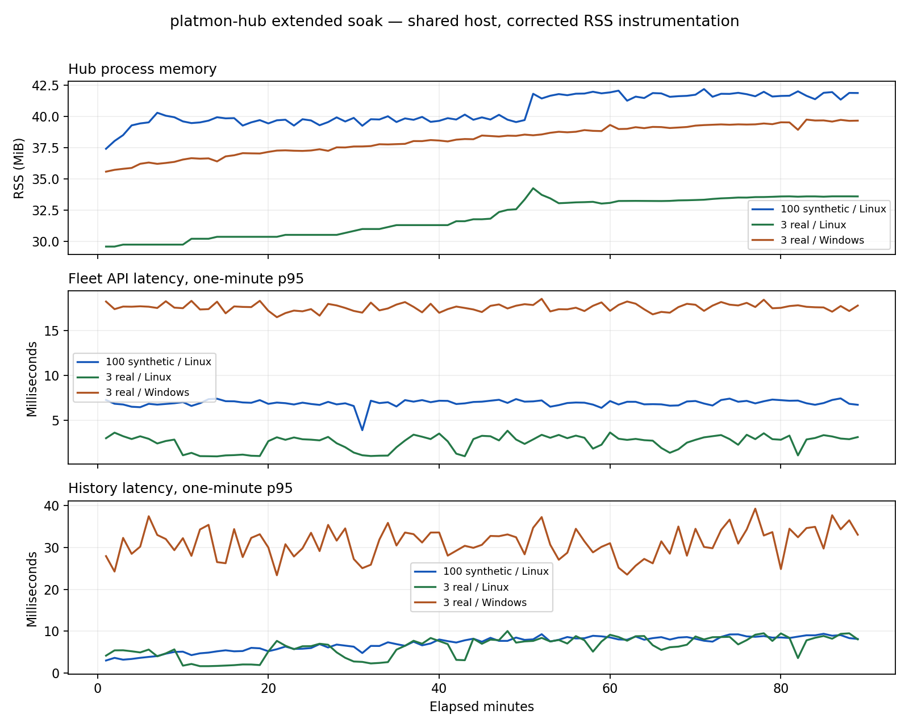

# Extended soak and performance investigation (2026-10-11 KST)

All three 90-minute acceptance runs completed successfully under the
[predeclared plan](long-soak-plan.md). The source runtime baseline was `0.2.0rc1`,
main `b4c3b26541aef182197b1e12bba877d0cc592437`, with corrected instrumentation.
The final client-disconnect guard has separate focused/CI and ten-minute real-node
validation; it was added after the continuous acceptance processes had started.

[Aggregate windows and summaries](long-soak-summary.json) contain no device
identifiers or raw Agent values. Raw field reports, registry, heap snapshots and
screenshots remain private. The three real endpoints came only from the user's
approved registry. No Agent, installed Hub service or registry was modified.

## Workload and results

Synthetic: 100 small-payload loopback Agents, Linux/Python 3.12.3, five Fleet and
five rotating-node one-hour History reads per second. Real: three registered
Agents, both Linux/Python 3.12.3 and native Windows/Python 3.13.14, one Fleet and
one rotating-node History read per second. Polling remained 5s/10s, concurrency 16,
queue 2048, schema 4. Alerts were disabled. CPU excludes Agent and client processes;
process instrumentation overhead is included.

These processes shared one host, including bounded diagnostic profiles and
Dashboard sessions. The real Linux Dashboard ran from roughly minute 12 to 72;
a matched-view heap probe ran near the end. Diagnostic workload can affect the
baseline windows, so this is not an isolated platform regression comparison.

| Workload | Seconds | CPU / one core | RSS peak MiB | Worst minute Fleet p95 ms | Worst minute History p95 ms | Core interval p95 maximum |
| --- | --- | --- | --- | --- | --- | --- |
| 100 synthetic / Linux | 5400.092 | 6.357% | 44.184 | 7.420 | 9.397 | 5.554s |
| 3 real / Linux | 5400.102 | 0.707% | 35.582 | 3.801 | 10.052 | 6.174s |
| 3 real / Windows | 5400.195 | 1.157% | 39.871 | 18.564 | 39.232 | 6.343s |

Every recorded minute retained all expected nodes current. All normal writer drop
counters and HTTP failure counts were zero. SQLite quick_check was `ok`; protected
registry hashes and HTTP node identities matched. Each real platform had at least
5,300 successful reads of each API; synthetic had 25,788 reads of each API.
All predeclared absolute targets passed. These are worst one-minute p95 values,
not a p95 computed over the concatenated request set.

Synthetic persisted 101,453 core and 52,341 optional rows; closed DB size was
38,567,936 bytes. Real Linux persisted 3,008 core / 2,106 optional rows and Windows
2,989 / 2,105. Normal shutdowns took 0.346s, 0.116s and 0.357s respectively.
Queue peaks were 28, 0 and 5. Hourly retention/checkpoint executed twice on each
run without errors or clock discontinuity; the second measured checkpoint cost
about 6.061ms, 8.739ms and 3.633ms. No rows were old enough for seven-day deletion;
aged deletion is covered by the separate storage and unit tests. WAL stayed near
4 MiB and is separate from the closed DB size.

## Defect: Windows RSS measurement retained types

The old benchmark created a new ctypes Structure and POINTER on every 200ms RSS
sample. The global pointer-type cache retained those types. In a Hub-free native
Windows probe, 1,000 repeated reads plus the final observation added 1,001 pointer
cache entries and RSS grew 11.543 MiB with allocation tracing enabled. A cached
reader retains one type; the same probe added zero entries and observed no RSS
growth. See [before/after evidence](windows-rss-probe.json).

The corrected reader has a 1,000-call native Windows regression test. Long-run
client timing retention is bounded and the resource sampler retains only its
current reading plus first/warmup/peak counters. Per-minute buffers clear after
reporting. The instrument no longer manufactures this unbounded type-cache trend.
This defect was in the benchmark, not the Hub runtime or Agents.

## Investigation: remaining RSS and latency growth

RSS after minute 30 still triggered the 1 MiB/hour analysis threshold: fitted
slopes were 2.707, 2.873 and 2.128 MiB/hour. Do not conceal that trigger behind the
functional `passed` flag. For synthetic, the slope after minute 60 fell to
0.062 MiB/hour. Real Linux was 1.074 after minute 60 and 0.377 after minute 75;
Windows was 1.313 after minute 60. Some real working-set growth remains, well below
the absolute budget, and its entire native allocator/cache contribution has not
been isolated. This evidence does not establish a leak-free service.

Separate 15-minute Windows and 20-minute Linux allocation profiles passed integrity,
registry and collection checks. Traced Python allocations grew approximately
0.676→1.072 MiB and 0.543→1.166 MiB. Source-cache/bookkeeping and dataclass tuples
were prominent. An isolated native Windows tuple probe retained 1,000 tuples after
1,000 calls, then capped at 2,000 tuples / 272,000 bytes through 8,000 calls; a full
GC cleared them. That component is bounded on the measured build, rather than an
unbounded application retention path. [Diagnostic aggregates](windows-stdlib-probes.json)
record the Windows probes; tracing changes timing/memory and is not a baseline.

History first/last 15-minute median window p95 increased about 2x for synthetic
and real Linux. The initial windows queried a growing short dataset; later windows
queried a full rolling hour. After minute 60, median window p95 was 8.561ms,
8.433ms and 32.619ms, close to the final 15-minute values 8.773ms, 8.426ms and
34.266ms. Fleet latency stayed similar. No runtime optimization was justified by
these values. An isolated empty Windows Hub also showed about 19–23ms p95 tails;
TCP_NODELAY and explicit proxy bypass did not consistently improve them. The exact
platform/host scheduling contribution remains unisolated; no TCP setting changed.

## Defect: normal client cancellation logged a traceback

During real Dashboard selection under allocation tracing, aborted History requests
produced three BrokenPipeError tracebacks. A disconnected viewer should finish its
request and release its admission slot. The handler now catches only BrokenPipe,
ConnectionReset and ConnectionAborted; other errors remain visible.

Focused tests cover all three disconnections, slot return, a subsequent successful
GET and preservation of unexpected-error reporting. A separate ten-minute three-real-
node run on the fixed handler passed (600.179s, 336 core / 238 optional rows,
integrity `ok`, shutdown 0.060s). An actual browser burst canceled 80 History requests
with zero server disconnect tracebacks, no JavaScript errors and all nodes Live.
No Agent polling or persistence semantics changed.

## Actual Dashboard memory checks

The real three-device Dashboard ran for 60 minutes with node/metric changes and
light/dark/mobile checks: all assertions passed, no JavaScript errors. GC-retained
Heap grew 1.242→2.454 MiB, but initial cold node/metric and final view differed.
A separate ten-minute probe warmed all views first, then held the same node/CPU
view with a full rolling-hour dataset. Retained Heap was 2.303→2.373 MiB, DOM nodes
stayed 677 and documents stayed 2. Snapshot code self-size grew 68,512 bytes,
accounting for most of the approximately 73 KiB JS increase; object self-size grew
3,016 bytes. This does not reproduce an application JS/DOM leak in that interval.
Native snapshot self-size also grew about 280 KiB; whole-browser RSS and indefinite
browser stability were not established. Raw snapshots are private.

## Limits and next operational evidence

The two reproduced defects are fixed; collection, durability and absolute latency/
resource targets passed. Remaining real working-set/native-cache growth needs a
longer deployment-specific pilot before a production memory plateau claim. The
workload excludes maximal payloads, seven-day databases, many simultaneous viewers,
alerts under prolonged faults, flaky DNS and real-device fault injection. Installed-
service reboot/ACL and upgrade acceptance remain separate. No release tag or
operational deployment was performed. The 256-node parser limit is not capacity.
