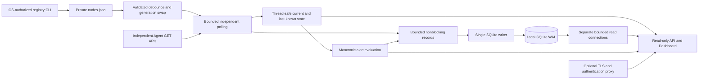

# platmon-hub architecture

[Documentation index](../README.md) · [Design reference](README.md)

This describes the implemented 1.0.0 release. Agent and Hub application/API
versions are independent; [the consumption contract](agent-contract.md) pins the
Agent status/stats schema 1 and observations schema 2.

## Responsibility boundary

Agents collect local hardware/system information, publish samples and keep their
own short memory history. Hub reads only `/api/status`, `/api/stats` and
`/api/observations`; it never imports Agent modules, copies hardware collectors,
controls Agents, discovers addresses or polls `/api/history`. Hub downtime or
storage failure does not stop an Agent. The Monitoring tab accesses Hub read APIs. The Devices tab uses the explicitly enabled local-only registry management routes.

## Components and concurrency

- `registry.py` validates canonical UUIDs, plain HTTP origins, duplicate IDs/origins,
  allowed fields and the 256-entry configuration limit. The limit is not a capacity
  guarantee. `nodes_cli.py` uses an OS lock, backup, fsync and atomic replacement.
- `runtime.py` schedules fairly across nodes with at most 16 tasks and one active
  request chain per UUID. Core and optional schedules are independent. Network
  calls run outside state/registry locks; late results from replaced generations
  are discarded. A removed/re-added UUID retains its active slot until old work ends.
- `reload.py` checks file changes every 250ms with 500ms debounce. Complete validation
  precedes replacement; invalid files leave the last good registry active. Renames
  preserve cached readings; endpoint/enabled changes reset live cache and preserve
  identity/history. In-flight network calls finish within their existing limits.
- `state.py` owns last accepted values, monotonic ages, transport counts and state.
  It returns an immutable acceptance record for new core samples. Queue admission
  and DB I/O never occur inside its state lock. Missing data stays null.
- `history/` separates projection, synchronous SQLite store, bounded writer and
  read-only queries. There is one writer/process owner, a 2,048-record queue and
  batches of at most 128. SQLite WAL/FULL and a 250ms busy timeout do not make queued
  data crash-durable. Storage diagnostics expose drops and errors independently.
- `alerts.py` evaluates configured rules once per second outside poll workers.
  Durations use monotonic time; active state and transitions commit through the
  same writer. Missing/stale evidence cannot resolve a numeric alarm as healthy.
- `http.py` serves exact static paths and bounded JSON read APIs; 32 connection
  slots, socket inactivity limits and a shared GET budget protect local resources.
  `web/app.js` uses textContent, local Canvas and cancellable bounded requests.

## Default polling and state semantics

| Setting | Implemented default |
| --- | --- |
| Core schedule | 5s after completion plus bounded jitter |
| Optional schedule | 10s after completion plus bounded jitter |
| Status / stats / observations timeout | 2s / 2s / 3s socket inactivity |
| Global / per-node concurrency | 16 / 1 |
| Response body bound | 512 KiB |
| Offline evidence | Two consecutive core transport failures |
| Hub listener | 127.0.0.1:9787; fixed explicit alternatives only |
| Agent port | 9797 |

Core polls validate status, then fetch stats only when ready. Required unknown
schemas produce `incompatible`. Valid ready/current data yields `live` or `partial`;
starting, stale, transport, protocol and schema failures remain distinguishable.
A valid status resets the transport counter, so succeeding status followed by a
stats timeout is not two consecutive failed requests. Optional failures never set
core Offline. Cached data ages by monotonic elapsed time and is visibly last-known
when noncurrent. Socket timeouts do not forcibly cancel OS DNS/filesystem stalls.

## Persistence, clocks and lifecycle

Hub UUID is stable across names, IP changes and Agent restarts. Core identity is
`(node_id, instance_id, sequence)`; optional identity adds group and observation ID.
Only newly accepted, fresh observations are stored. UTC milliseconds mean Hub receipt
time, not a fabricated Agent measurement clock. Monotonic time drives freshness,
scheduling, query budgets and alerts. Wall-clock discontinuity suspends retention
until operator investigation/restart acknowledgment.

Schema 4 contains core/optional observations, continuity/gaps, Hub sessions, events
and alert state. Migrations are ordered transactions with verified backups; unknown
newer schemas leave history unavailable while Fleet API remains useful. Gap causes
are evidence-based; unknown shutdown periods are unobserved, never invented network
outages or zero samples. Query aggregation preserves extrema/nulls/generation edges.
See [schema](history-schema.md) and [storage decisions](adr/0002-hub-history-storage.md).

Startup validates registry/config and binds the fixed port before starting workers.
History initializes independently. Shutdown stops reload/scheduling, finishes poll
work and attempts a five-second writer drain. OS-level blocking can exceed graceful
limits; forced termination may lose queued records. An Agent remains independent.

## Operations and limits

OS-authenticated local administrators manage config/services. Proxy viewers receive
read-only access. Opt-in [local web registration](../guides/web-registration.md) enables
explicit Registry management routes for trusted local users with strict Origin
and non-simple request-header checks. There is no arbitrary URL proxy, discovery, external notification delivery
or Agent control. Default loopback
and canonical brand assets remain unchanged. See [security](../guides/security.md).

Installation/backup/restore are documented in [operations](../guides/operations.md).
Cross-platform CI, actual three-device checks and synthetic experiments are evidence
for the candidate, not proof of unattended production stability. See
[resource budget](../development/resource-budget.md) and [remaining release gates](../development/release.md).

## Opt-in replay boundary

[ADR-0003](adr/0003-agent-replay-and-raw-publications.md) extends the original
three-endpoint Live policy with two fixed replay GET resources only when raw
capture is enabled. `replay.py` coordinates fair per-stream page turns in Fleet's
existing per-node/shared worker bounds, after due Live work is admitted. It
confirms process identity without feeding archived data to NodeState or alerts.

Immutable validated raw pages and cursor-read commands enter a separate page/byte
bounded queue on the existing SQLite writer. At most one raw page commits per
writer turn after summary writes; lightweight cursor reads can share that turn.
Durable completion, not admission, releases the stream for another page. Schema 6
stores raw publications, transactional cursor/loss evidence and quota accounting;
existing selected History/CSV/report consumers continue using summary tables.
Read-only `raw-export` streams committed JSONL with bounded rows/bytes/time.
See [raw capture](../guides/replay.md) for defaults, explicit capacity settings and
coverage limits. Operational seven-day/fault/long-soak gates remain open.
